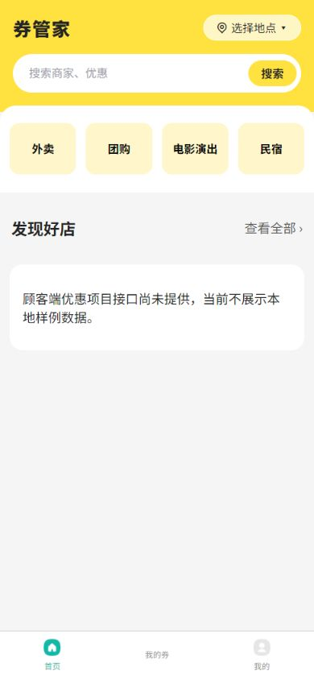
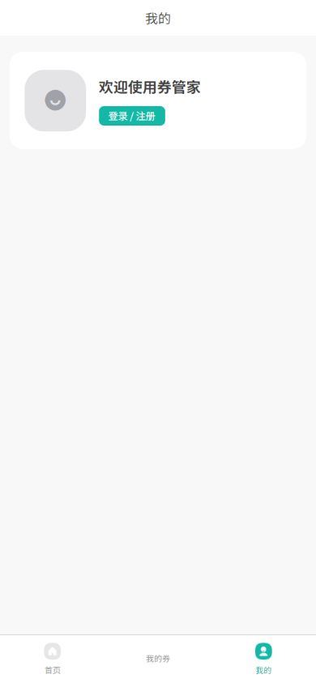
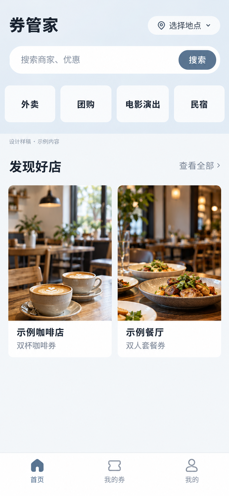
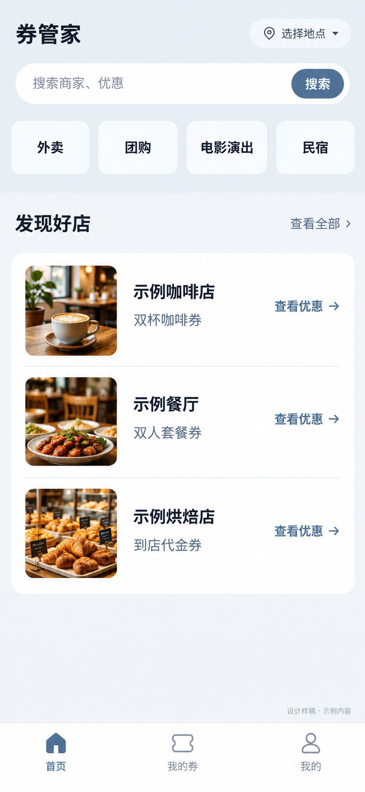
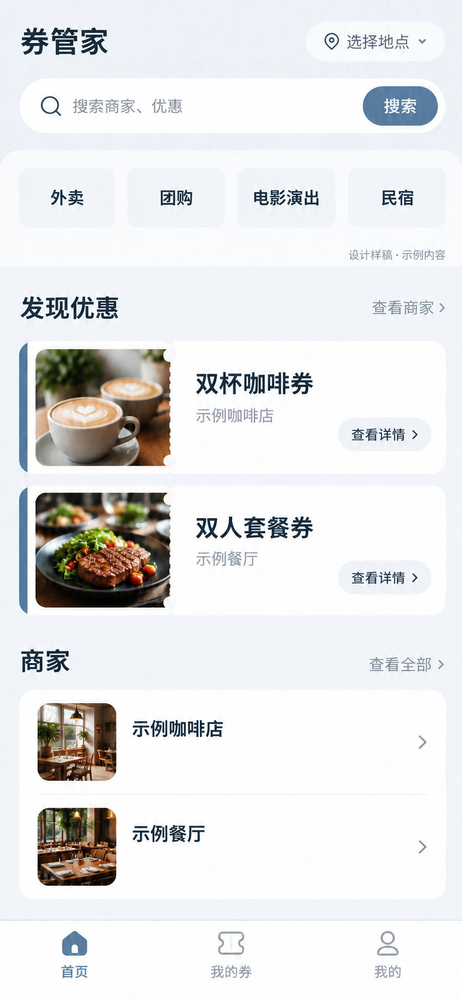

# 客户端功能清理与布局美术规划

日期：2026-10-20。范围：`apps/client`。业务依据为根目录《券管家3.0_数据库表规划(1).md》和已交付的账号接口契约。

## 功能清理结果

| 项目 | 判断和处理 |
| --- | --- |
| 购物车、假商家、假支付 | 本次检查时已从当前业务中移除；不恢复、不作为3.0需求。 |
| 通用设置中的深色模式、多语言、字体大小 | 无本项目需求依据，移除应用页面和入口；保留框架底层能力。 |
| 通知开关 | 无服务端保存或系统授权逻辑，移除。规划中的站内消息功能仍是后续接口需求，两者不可混同。 |
| 空的隐私设置入口 | 没有对应行为，移除。登录和注册现有协议区域保留；协议正文仍需项目方提供。 |
| 关于、访问官网、联系我们 | 实际指向 Cool Unix 官网、模板 Logo 和作者微信二维码，移除相关页面和组件。 |
| 个人简介、生日、地区编辑 | 当前资料接口不接受这些字段，移除入口、独立简介页及提交逻辑。 |
| 头像上传 | 有 avatarUrl 资料字段，但当前没有交付上传接口契约；移除上传/选头像按钮，保留现有头像展示。 |
| 微信登录组件 | 登录页未使用且接口契约未交付，归档移除；保留已交付的短信/密码登录、手机号注册。 |
| 重复设置入口 | 个人中心同时有右上角图标和列表项；移除重复图标，保留列表入口。 |
| 框架 demo/shop 模板 | 已不在注册路由中，不属于当前产品功能；源码仅作框架参考，不从客户端入口开放。 |
| 首页四类入口 | 这是用户此前明确要求的外卖、团购、电影演出、民宿四个浏览入口，保留；不据此新增配送、选座、订房等履约功能。 |

应用设置和资料相关页面/组件共归档移除8个；注册业务路由从14个减少到10个。备份位于 `.scaffold-backup/20261020-client-scope-cleanup`，没有覆盖其他四端。

保留页面：首页、我的券、我的、商家列表/详情、设置、资料/昵称编辑、登录、注册。后端业务接口尚未交付的商家和券页继续显示待接入状态；缺少接口不代表该功能应从3.0规划删除。

资料保存仅发送已确认的 nickName、avatarUrl、gender 三项，成功后重新读取个人资料；失败不先修改本地资料。手机号只读。

## 当前画面检查

1. 首页：清理前截图记录了旧黄主题。用户后来否定黄色并选定蓝灰白样稿1；当前运行界面已切换为蓝灰白，商家数据区仍遵守待接入状态，不向应用填入假数据。
2. 个人中心：未登录时登录入口明确；设置与资料功能需登录后使用，本轮不伪造账号或绕过鉴权。
3. 登录：去除模板 Logo，保留项目名称、短信/密码两种已有登录方式与注册入口。
4. 原设置/资料扩展项：以源码、注册路由和现有接口文档核对；没有测试账号，未声称完成登录态下真实资料保存或短信联调。

当前运行截图：

## 共同布局与美术规则

用户已选择蓝灰白作为客户端视觉方向，并选择样稿1“商家双列、大图卡片”（2026-10-20）。方案已应用于客户端首页、我的券、个人中心与底部导航。商家端和其他应用主题不因本次选择而变化。

- 主要强调色为克制的蓝灰 #526D88，浅蓝灰底色 #EEF2F6，正文 #26313B，次要文本 #71808D，内容表面白色；新样稿不再使用黄色。
- 中文系统字体；页面名23px、分区标题20px、商家/券名称16px、正文14px、辅助说明12px。使用字重、间距和对齐体现层次。
- 设计以390×844手机内容区为基准；左右16px留白、模块间距16–24px、控件间距12px；主要触控区域至少44px。
- 以留白、细分隔线和节制的圆角建立层级，不给每个信息区叠加阴影卡片。
- 底部继续三个入口：首页、我的券、我的。原生tabBar三项图标需要统一大小、线宽及选中态；不使用购物车图标替代优惠券图标。
- 商家名称、券名称、价格和适用范围各归其位，不把商家对象当作商品或订单明细。价格、距离、评分、销量仅在后端真实提供且确属需求时展示。
- 图片来自正式商家资料，失败显示名称；样稿里的图片仅用于静态布局演示，不放入业务接口或种子数据。

## 页面布局规划

| 页面 | 内容顺序与主任务 | 数据边界 |
| --- | --- | --- |
| 首页 | 项目名/地点 → 搜索 → 四类浏览入口 → 商家双列大图卡片 → 三项底部导航 | 用户确认后端已有商家查询接口和已入驻数据；前端路径、参数、DTO 与服务地址尚未同步，接入前显示待接入状态，不显示样例卡片。 |
| 商家列表 | 标题/返回 → 搜索与分类 → 商家列表 → 加载/空/错误状态 | 分类ID、搜索范围和分页以后端契约为准，不从模板固定ID推定真实分类。 |
| 商家详情 | 商家信息 → 门店地址、营业时间和电话 → 适用优惠券 | 当前旧数据类型混合了商家与商品信息，接真实契约时再拆分模型，不臆造字段。 |
| 券详情（后续） | 券名称/规则 → 有效期和适用门店 → 对应领取或模拟购券动作 | 动作由券定义和后端规则确定，暂不新建未确认业务流程。 |
| 我的券 | 未使用/已使用/已过期状态 → 券条目 → 券码详情与适用范围 | 券状态和核销结果由后端提供；不在客户端生成真实持券或改成已核销。 |
| 我的 | 登录身份 → 个人资料/设置；订单、关注、消息、反馈按规划和接口交付后排期 | 本轮不把尚未接入的菜单塞进运行界面。储值积分是扩展模块，暂不做假余额或等级。 |
| 资料/设置 | 头像展示、昵称、手机号、性别；设置保留退出登录 | 使用现有账号接口；不恢复生日、地区和简介等不支持字段。 |
| 登录/注册 | 项目名称 → 单一主表单 → 登录方式切换/返回注册 → 现有协议区域 | 短信、密码、验证码走现有接口；协议正文和上传接口仍待提供。 |

## 三张蓝灰白静态候选样稿

样稿使用内置 ImageGen，均参考本次实际首页截图；用户已选择蓝灰白配色。每张图为独立手机页面，不是上线页面；图中的示例商家和优惠只用于评审布局，不作为真实数据。

### 样稿1：商家双列

双列大图商家卡，图片承担发现感，券名作为商家卡的次级信息。顶部四类入口保持文字浏览按钮。

### 样稿2：商家条列

一个分组表面承载横向商家行，适合快速比较和阅读较长名称；不拆成多个浮起卡片。

### 样稿3：优惠券主导

先展示券内容，再显示商家名称。优惠券卡片有轻量票券轮廓，商家区域只保留名称，没有额外标签或假指标。

三张图均没有购物车、真实支付、评分销量、AI或新增履约功能。静态样稿中的商家与优惠信息是排版示例，不会作为运行时数据。

## 实施顺序

多余功能清理和样稿1落地已完成。首页采用双列大图商家卡片结构；我的券与个人中心沿用相同蓝灰白色板，底部三个原生 tab 使用统一灰/蓝灰图标。商家查询仍待前端按已确认的后端契约接入；在端点、参数、DTO 和可访问服务地址同步前，首页展示待接入说明，不显示样例卡片。H5 与微信小程序由 HBuilderX 5.26 编译通过。H5 页面截图：

