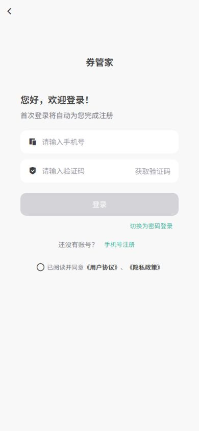
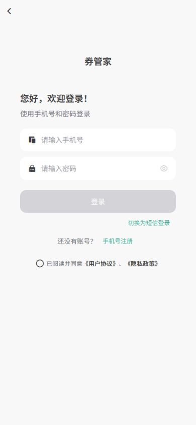
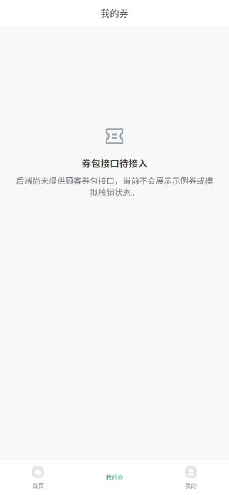
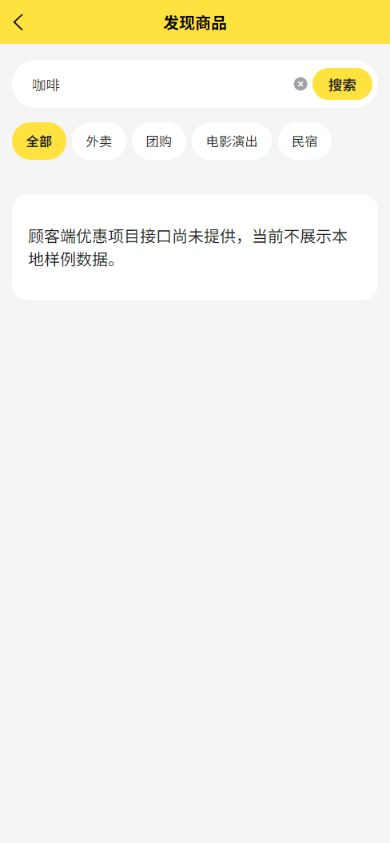
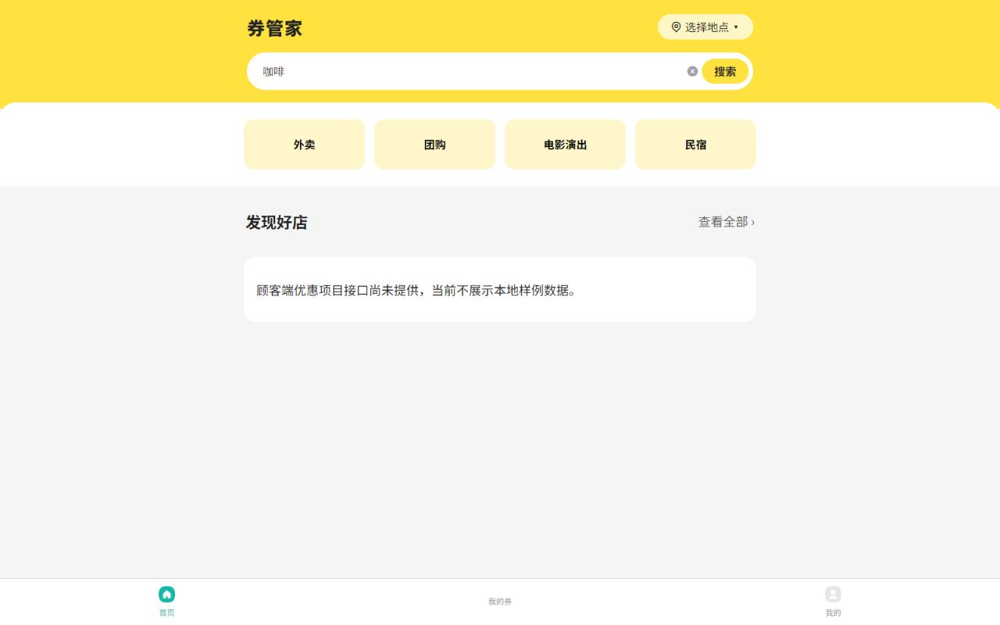

# 客户端清理验证记录

日期：2026-10-20。记录客户端清理验证，以及用户选择样稿1后的视觉实施检查。样稿图仍是静态设计参考；运行时不使用样稿中的示例商家数据。

## 已完成

| 检查 | 结果 |
| --- | --- |
| pnpm check | 通过；五端结构、路由、平台标识、共享样式及36个业务SFC。 |
| 客户端全部注册路由SFC解析 | 10个页面全部通过，含设置、资料、登录和注册。 |
| pnpm test:client | 6项通过：四类入口、无契约时拒绝返回样例、注册路由/跳转完整、选址边界、资料保存失败不先改本地、成功后读取后端确认值。 |
| pnpm test:shared | 原有4项共享演示工厂检查通过；不代表真实后端跨端联调。 |
| pnpm format:check | 通过；本轮修改的设置/资料/登录/个人中心页面另按Vue解析器完成格式检查。 |
| frontend-design-premium strict静态审计 | 0 findings，结果保存为 ui-static-audit.json。静态结果不等同完整无障碍或真机验收。 |
| HBuilderX微信小程序开发编译 | 10页面编译成功，编译器5.26、uni-app x VDOM模式。 |
| HBuilderX H5开发编译 | 成功；Vite按需编译。 |

## 浏览器检查

使用Codex内置浏览器查看实际H5开发页面，手机宽度390px，辅助预览宽度1280px。

1. 首页：品牌、搜索和四个已确认入口显示正常；无商家样例、购物车或假价格。手机和宽屏均无可见横向溢出；1280px实测scrollWidth=1280，四个入口等宽155px。
2. 个人中心：未登录时显示真实登录入口；不展示假会员统计。登录态设置/资料未使用伪造Token绕过鉴权。
3. 登录：模板Logo已去除，短信/密码切换正常，未填任何手机号、验证码或凭据，未提交真实登录/注册请求。
4. 搜索：输入“咖啡”后进入已注册列表页面，搜索文本正确显示，列表明确展示真实接口待接入，不返回假商家。
5. 我的券：待接入状态保留；原先不存在的coupon-3-line图标改为项目已安装的coupon-line，不显示示例券码或假核销状态。

## 截图

## 仍待真实环境验证

没有进行短信发送、真实账号登录注册、真实资料保存、微信定位授权或真机交互验收。资料保存的失败/确认后更新行为在隔离单元测试中验证，测试数据没有进入应用运行逻辑。

协议正文、头像上传、券/订单等业务接口未交付，相关功能不使用前端假流程补齐。用户已确认后端存在商家查询接口和已入驻数据，但前端契约仍待同步。未声称通过完整键盘/读屏/200%缩放等扩展无障碍矩阵。

## 蓝灰白样稿1实施后补充

- HBuilderX 5.26：H5 编译成功；微信小程序编译成功，10个注册页面均完成编译。
- H5 内置浏览器以390×844视口检查首页、我的券和个人中心；运行时主题与用户选择的蓝灰白一致，底部三个原生 tab 已换成统一灰/蓝灰图标。
- 首页商家双列卡片结构与图片区域比例已实现；后端已有商家查询和已入驻数据，但前端端点/参数/DTO/服务地址尚未同步，当前展示明确的待接入说明，不显示样稿示例卡片。
- 本次页面证据：`09-home-sample1-implemented.png`、`10-voucher-bluegray.png`、`11-profile-bluegray.png`。微信端仅完成编译，未使用微信开发者工具或真机验收。
- 排查并修复了顾客页面的 uni-app x 生命周期导入告警和商家搜索关键字可空类型告警；最终 H5 页面控制台未见错误或警告。
