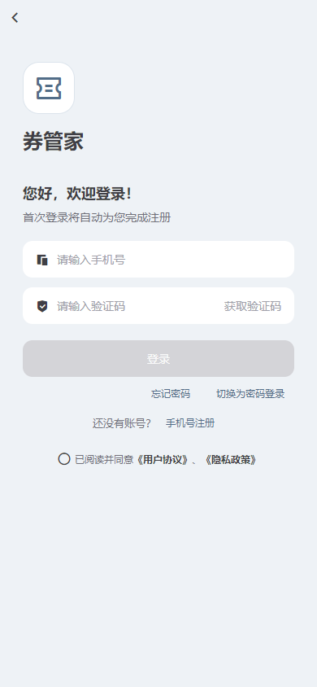
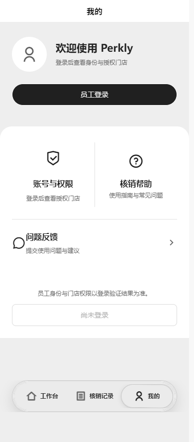

# 客户端与商家固定浅色（2026-10-25）

用户要求移除两端深色模式，避免设备深色偏好造成页面与组件颜色不一致。

## 实现

- 两端 `.cool/theme/index.ts` 为唯一适配入口：只读 `theme=light`、`isDark=false`、`isAuto=false`；不再读取或监听系统、微信宿主和父窗口主题。保留 Cool 组件 API 签名，旧的切换调用也只会应用浅色。
- `manifest.json` 的微信和 H5 `darkmode=false`；`theme.json` 删除 dark 配色；`pages.json` 的标题栏、背景和原生 TabBar 直接使用已有浅色值，不再依赖 `@` 主题变量。
- H5 HTML 启动时声明 `color-scheme: only light`；主题适配器清理遗留的根节点 dark 类。
- 删除客户端设置页、商家模板通用设置页的深色开关，移除两端 Cool `cl-page` 中的主题按钮及其组件源文件。
- 组件库中未启用的深色样式分支保留兼容性；不再有可进入这些分支的主题状态或界面入口。其余三个独立应用未修改。

## 验证

- `pnpm test:theme`：8 项通过。执行生产主题控制器，分别模拟微信/H5/APP 边界，覆盖深色设备启动、旧切换调用、自动主题请求、页面颜色覆盖和平台配置。
- 既有共享、客户端、商家、交易与玻璃导航测试：40 项通过；合计 48 项测试通过。
- `pnpm check`：五端结构与 43 个业务 SFC 检查通过。
- `pnpm format:check` 及本轮文件格式化通过；`git diff --check` 通过。
- DESIGN lint：0 错误、0 警告；严格 UI 审计 0 错误、0 警告，见 `premium-audit.json`。
- HBuilderX 5.26 最终微信开发编译：客户端 16 页、商家端 10 页通过，日志分别为 `client-mp.log`、`merchant-mp.log`。
- 最终微信产物核对：两端 `darkmode=false`，原生标题文字为 black、标题背景为浅色，未保留原生主题变量、dark 配色或主题按钮注册，见 `mp-results.json`。

H5 使用实际开发服务（客户端 9900，商家 9902）与无头 Edge，在 390×844、系统深色偏好下检查客户端首页/登录页和商家工作台/我的。覆盖深色启动、运行中 light→dark 切换及旧 `theme-change` 父窗口消息；配色保持一致，没有 `.is-dark` 节点、主题开关或页面脚本错误。原始结果见 `browser-results.json`，可复现脚本为 `verify-browser.cjs`（通过 `PERKLY_THEME_PLAYWRIGHT` 指定本机 Playwright 模块）。

| 客户端深色设备环境                        | 商家端深色设备环境                          |
| ----------------------------------------- | ------------------------------------------- |
|  |  |

另有 `client-home-dark-device.png`、`merchant-home-dark-device.png`。这些截图是 H5 的深色设备模拟证据，不是微信真机截图；本轮没有 iOS/Android 真机验收。

商家入驻及员工邀请仍处于流程讨论，本轮未增加模拟账号或新接口。后续可通过隔离的测试数据验证新流程，再按后端契约替换。
