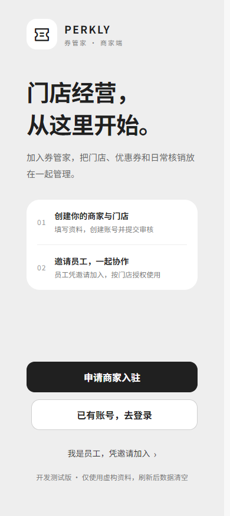
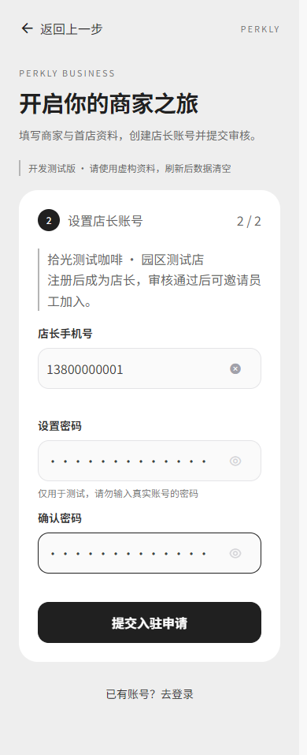
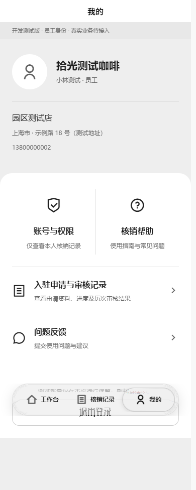

# 商家欢迎、入驻与员工邀请（2026-10-25）

> 最新边界（2026-10-25）：员工邀请、注册和人员管理已从当前手机端移除，归商家后台；下文邀请相关内容仅为当时实现/验收的历史记录。当前实现与回归见 [移除记录](../merchant-staff-removal-20261025/README.md)。

> 当前状态（2026-10-25 收尾）：员工邀请、开发测试账号、示例位置均已删除；入驻保留两步骤界面，但提交与审核接口未接通，按钮明确禁用。下文为当时实现与验收记录。

用户授权先以测试数据完成前端流程，延续已选择的第三套黑白灰风格。实际代码位于 HBuilderX 工程 `apps/merchant`，新增页面与工作台共用同一工程、同一构建；微信开发者工具仍打开 HBuilderX 产物。

## 流程

- 欢迎：申请商家入驻、已有账号登录、员工凭邀请加入。
- 入驻：商家名称、首家门店名称（可选）、地图位置 → 店长手机号及密码确认。微信调用 chooseLocation；开发测试也可明确选择示例位置，H5未配置地图服务时给出提示。
- 注册后为店长账号，进入自己的商家/门店。“我的”显示身份与门店信息；店长“员工管理”生成24小时单次邀请码、复制、撤销、查看已加入员工。
- 员工先验证邀请码，确认所属门店，再填写称呼和账号；角色固定员工。员工看不到店长专属入口，直达管理路由也被拒绝。
- 所有私有商家页要求登录。登录失败保留手机号并清空密码；错误定位首个字段；两步返回保留草稿，自定义离开确认丢稿；提交锁和卸载保护由共享表单逻辑负责。
- 欢迎与认证页不显示底部导航；已登录主页面保留原三项玻璃导航。

## 当前数据边界

`api/merchant-auth.ts` 仅在 `NODE_ENV=development` 启用独立的内存服务。没有预置账号，账号和邀请码来自本次运行；退出可重新登录，刷新会丢失全部测试资料。密码、手机号、邀请不写Storage，不发网络请求，不生成正式Token。使用虚构资料测试。

正式 `stores/session.ts`、商家13项真实能力、客户端现有接口没有接入测试身份；真实核销/统计/券/反馈保持待接入。发布版账号请求继续明确拒绝，不能把开发测试开关作为上线认证。后端能力交接见 `docs/MERCHANT-API-HANDOFF.md`。

同日用户在另一聊天授权的入驻审核已联合接上：注册后可登录，但审核通过前不能使用经营能力。在“我的 → 入驻申请与审核记录”查看申请，开发版可显式展开模拟审核工具，手动通过后才可邀请员工。首页审核通过提醒仅作通知，确认后收起首页提示，历史仍保留。不会自动审核通过，审核专项见 `docs/merchant-admission-20261025`。

## 组件和风格

- `merchant-auth-shell/field/button` 复用 Cool `cl-page/cl-form/cl-input/cl-button/useUi`；`useMerchantAuthForm` 统一错误、提交锁、首错定位与卸载隔离。
- `merchant-auth.scss` 消费现有 `merchant-monochrome.scss` 中性变量；认证页最大480px，卡片圆角24px，主次按钮及输入均52px高/14px圆角；文字操作44px。
- H5原生标签、输入的ARIA/自动填充属性由 Cool 适配器与 `h5/auth-controls.js` 补全；密码显示/隐藏、清空和按钮支持键盘。确认弹窗复用 Cool，补焦点圈定、Escape取消和焦点恢复。该DOM适配不进入小程序。

## 验证记录

- `pnpm check`：五端结构与53个业务SFC通过，见 `structure.log`。
- 全部63项Node回归通过，包括账号、邀请、审核、会话隔离、角色/门店授权、客户端交易、主题与玻璃导航，详见 `tests.log`。导航时序补丁后13项玻璃回归另行通过。
- `pnpm format:check` 通过；本轮商家组件/样式/H5适配器格式检查通过；`git diff --check`通过。
- 严格 UI 审计0发现（`premium-audit.json`）；官方 DESIGN.md CLI lint 0错误0警告（`design-lint.json`）。
- HBuilderX 5.26 最终微信15页开发编译通过（10:20:52，晚于导航最终修改10:18:55）。由审核聊天统一执行，日志 `docs/merchant-admission-20261025/merchant-mp.log`，避免两个编译进程覆盖同一产物；已核对生成app.json首路由为welcome、15页和三项Tab。
- H5 Edge `verify-browser.cjs` 全流程13张场景截图通过，0页面错误、0写请求，见 `browser-results.json`。覆盖未登录私页拦截、入驻校验/丢稿取消、注册店长、显式模拟通过/首页提醒、邀请码生成与撤销、无效邀请、员工注册/角色隔离、退出与错误密码恢复、店长重登看到员工、320px布局、刷新清空。没有直接篡改应用会话或自动审批来绕过流程。
- 表单独立脚本 `verify-forms.cjs` 5场景通过（`form-results.json`）：两步返回保留、密码键盘显示/隐藏、首错焦点、真实label点击、丢稿确认/开场立即Escape取消、52px按钮/14px圆角、320px及390px布局、深色设备下固定浅色。
- 修复切页时缓存导航组件调用 hideTabBar 的时序：只在当前tab路由调用，并处理预期平台失败回调；未更改玻璃光学、弹簧或三项路由行为。

微信地图选址、隐私授权、手机键盘、系统返回手势及真机效果尚未实测；H5截图不作为小程序实测。没有发布、提交远程代码或运行真实业务服务。

## 自己测试

1. HBuilderX 打开 `apps/merchant`，运行到浏览器或微信小程序。微信开发者工具打开生成的 `apps/merchant/unpackage/dist/dev/mp-weixin`。
2. 欢迎页 → 申请商家入驻，使用虚构资料；H5可选择示例位置，注册店长。
3. “我的 → 入驻申请与审核记录”查看申请；测试阶段展开“开发测试：模拟平台审核”，手动通过（或先驳回、修改重提）。
4. 返回工作台确认提醒，再去“我的 → 员工管理”生成邀请码。退出账号，欢迎页选择员工凭邀请加入，用另一虚构手机号注册。
5. 员工应看不到员工管理/建券入口；退出后再用店长账号登录应看到已加入员工。不要刷新，否则本次测试资料会清空。

## H5截图

| 欢迎 | 店长账号 | 员工个人中心 |
| --- | --- | --- |
|  |  |  |

其余场景文件由两个验证脚本生成；均为虚构资料的开发测试截图。
