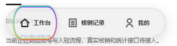
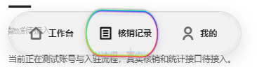
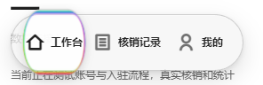

# 商家透镜棱彩增强

**历史记录：用户已明确否定彩色描边；当前已移除谱色image、PNG和生成脚本。后续以 [导航速度响应与性能](../nav-speed-20261025/README.md) 为准，不依据本报告恢复彩边。**

2026-10-25，按用户要求增强选中透镜四周的棱彩感。之前商家样式将H5彩边覆盖为灰色，小程序没有彩边。当前两端都会沿透镜完整轮廓显示多色边带，按住时更明显，拖动中随父透镜拉伸、倾斜和弹簧吸附，中心保持透明且文字不染色。

## 实现与限制

- 商家 `merchant-floating-nav.uvue` 复用现有透镜，增加装饰性image。约3.4px的谱色边带由法线角度和向内深度计算，不是整张彩色背景；中心alpha为0。4倍分辨率PNG约22KB，通过 `scripts/generate-merchant-prism-rim.mjs` 可重复生成。静止opacity为0.76、按住1，不增加动画循环、Canvas更新或背景截图。
- H5共享适配器增加可选色散参数，商家RGB位移间距为7.2、客户端默认仍为2.4；增强的是现有真实背景RGB拆分位移。浏览器实测SVG三个通道的scale间距为7.2，中心位移仍由原位移场保持中性。商家旧灰色伪元素已移除。
- 微信端直接使用同一透明边缘纹理，不依赖DOM、CSS mask、SVG滤镜。这是棱彩外观模拟，微信真实动态背景折射仍待适配和验收；没有新增整页逐帧截图。
- 高对比和减少透明度时隐藏彩边，选中状态仍有文字和中性透镜。保持黑白灰内容和无白色光斑的既定要求。

## 实际截图

H5实际增强模式：

320px宽度、禁用H5光学支持后的材质回退预览：

最后一图是H5浏览器中的同材质回退，**不是微信小程序或真机截图**。它仅验证没有SVG滤镜时，边缘纹理仍可显示且跟随形变。

## 验证

- [浏览器脚本](verify-browser.cjs)和[结果](browser-results.json)：390px增强/320px回退各覆盖静止、按住、拖动3态，松手到“我的”页，所有透镜无祖先裁切；高对比隐藏装饰，0页面脚本错误、0写请求。
- 67项既有Node测试全部通过；51个业务SFC结构检查通过；[测试日志](tests.log)。
- HBuilderX 5.26商家13页微信开发编译成功；[编译日志](merchant-mp.log)。生成产物包含新image、谱色PNG和opacity状态样式。
- [四周图像检查](rim-pixels.json)确认按压截图上、下、左、右都有可见色差像素，源纹理中心完全透明；编译后PNG的SHA256与源文件一致。
- [客户端运行检查](client-default.json)确认仍无新增谱色image，H5通道scale间距仍为默认2.4。仓库格式与修改文件格式通过，[严格UI审计](premium-audit.json)0发现，[DESIGN lint](design-lint.json)0错误/警告。
- 修复后微信真机图像、动态背景折射与触摸帧率尚未实测；上述H5图和编译结果不能替代微信真机验收。
